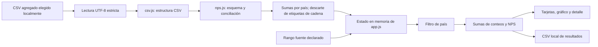

# Arquitectura de los módulos locales

Aplicación estática de HTML, CSS y JavaScript sin framework ni dependencias de ejecución descargadas. Se sirve por HTTP local para usar un origen consistente en la aplicación y sus pruebas.

Flujo del módulo NPS:

## Responsabilidades

- `csv.js`: parser estricto de coma, límites, filas físicas, encabezados, exportación y estado genérico. Su API también permite punto y coma explícito; la interfaz NPS solo admite coma.
- `nps.js`: esquema por país y dos adaptadores de origen, conteos no negativos y enteros seguros, claves de origen, conciliación, validación del periodo declarado, agrupación por país y exportación sin cadenas. Sus funciones no acceden al DOM ni a la red.
- `app.js`: File API, decodificación UTF-8 fatal, metadatos de origen, filtros, renderizado seguro y descargas Blob. Un contador de generación descarta resultados de lecturas anteriores tras una nueva carga o reset.
- `index.html` y `styles.css`: interfaz accesible con etiquetas, estado anunciado, tablas con encabezados y gráfico con alternativas textuales. La tabla ancha se desplaza dentro de su contenedor en pantallas pequeñas.
- `tests.js` y `nps-tests.js`: lógica determinista con fixtures sintéticos; `ui-tests.js` verifica la integración en navegador en un iframe local.

No existe sincronización, backend de métricas, base de datos, credencial ni acceso al BI. El código no abre reportes ni comprueba sus filtros. Los metadatos reales de origen se revisan fuera del repositorio.

## Contrato de estado

Cada carga comienza vaciando datos y errores anteriores. Un archivo inválido no aporta filas parciales. Las fechas pueden declararse antes o después de cargar, pero no se calculan indicadores hasta validarlas. Las fechas describen el agregado completo y nunca cambian sus filas.

La interfaz convierte los datos importados a filas de país antes de guardarlos en su estado. No conserva nombres ni claves de cadena en ese estado, no ofrece un filtro de cadenas y no muestra nombres de archivo. Los conteos de tarjetas, gráfico, tabla y exportación provienen de la misma selección de países. Las claves duplicadas por variaciones de mayúsculas se identifican antes de consolidar; no se agregan duplicados silenciosamente.

`window.NPSApp` expone únicamente `loadFile` y `reset` para las pruebas de integración locales. No ofrece acceso externo ni persistencia. Los ejemplos son datos generados en el repositorio, sin conexión con operaciones reales.

## Agendamientos

`agendamientos.js` reutiliza el parser CSV y aplica un contrato de dos cortes fiscales de creación por país. Cada país debe existir una vez en cada corte. `select`, `total` y `exportResults` requieren el identificador de un corte; no hay API de total global que mezcle duraciones distintas. Las filas de estado solo contienen país, clave normalizada, corte y conteo. La incertidumbre del calendario y la falta de certificación de completitud forman parte de la exportación.

`agenda-app.js` gestiona carga UTF-8, selecciones, DOM mediante `textContent`, descargas y descarte de lecturas antiguas. Contexto opcional de disponibilidad se valida y se borra al cargar otro archivo sin contexto. No afecta el cálculo. `agendamientos.html` y `agenda.css` componen una vista independiente; comparten estilos básicos con NPS y se enlazan entre sí. La copia privada se construye fuera del repositorio con un boot separado; no modifica los fixtures de la demo.

## Ventas EUR

`ventas.js` valida país/EUR/importe entero visible y conserva el grupo sin país con clave separada. `total` rechaza monedas mezcladas y precisión insegura. La exportación incluye periodo, precisión, cobertura y origen declarado. `ventas-app.js` maneja lectura UTF-8, contexto temporal, selecciones, DOM seguro y descarte de cargas antiguas. Los periodos describen el archivo completo. HTML/CSS y suites de pruebas son independientes de NPS y agendamientos; la copia privada se construye fuera de Git.

## Cotizaciones

`cotizaciones.js` valida un país y cuatro enteros no negativos por fila. `totals` suma cada medida por separado y no produce un total que mezcle métricas. `exportResults` conserva periodo, ventana declarada, contexto de cohorte y origen. `cotizaciones-app.js` controla carga UTF-8, selección de país y medida gráfica, DOM seguro y descarte de cargas antiguas. `cotizaciones.html` y `cotizaciones.css` forman una vista independiente. Las copias privadas se construyen fuera de Git; no cambian los fixtures sintéticos.

## Entrada y distribución

`home.html` presenta cuatro alcances sin sumarlos. `navigation.css` mantiene el mismo orden y página activa en cada vista. La navegación carga documentos separados; no existe estado global, sincronización de filtros ni transformación entre esquemas.

`regression.html` ejecuta las suites de interfaz y la integración. `integration-tests.js` ejercita navegación real de documentos en un iframe, Back/Forward, recarga, imports mediante File input y exportación capturada en memoria.

`serve_demo.py` sirve archivos permitidos del proyecto exclusivamente en loopback. `tools/prepare_package.py` construye un ZIP local desde `package-files.txt`, con manifiesto de tamaño y SHA-256, sin leer carpetas privadas. Las copias de datos reales y su entrada común se construyen fuera del repositorio.
